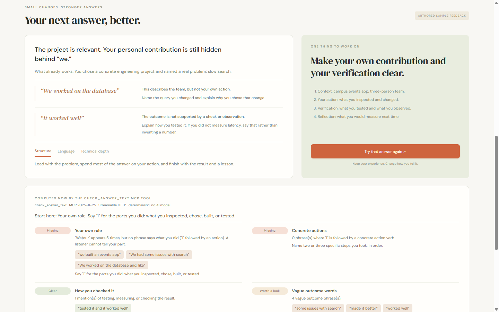

# Rehearsal — interview practice that shows you exactly what to change

Rehearsal is an interview-practice room for technical-internship candidates, including non-native English speakers. An illustrated interviewer asks a behavioral question, you answer out loud or in writing, and you get feedback tied to the **exact words you used**, one priority to fix, and a side-by-side check of whether your retry actually changed.

The coaching engine is a self-hosted **MCP server** (spec **2025-11-25**, Streamable HTTP). Its core tools are deterministic and need **no API key**, so any MCP client — or a voice assistant such as Alexa+ — could call them. (Alexa+ itself was not available to entrants for testing.) The browser app is a simulated Alexa+-style practice experience built on those same tools.



> Hackathon track: **Alexa+** — self-hosted MCP server, plus a simulated Alexa+ experience in a web app.

## What works today, and what does not

| Part | Status |
|---|---|
| Authored sample interview (animated interviewer, browser speech, coaching, retry, comparison) | Works. The sample answers and the main coaching card are **written by hand** and labelled as such. |
| Rule checks on the sample answers | Works. Computed live by the MCP tools `check_answer_text` and `compare_answer_texts` every time the sample runs. |
| Practice with your own answer: record audio locally, or type an answer | Works (recording verified with Chrome's fake microphone device; try your own mic). Audio stays local unless you select Gemini review or browser captions. |
| Optional browser captions while recording (opt-in) | Implemented and unit-tested with a mocked recognizer; real speech results not yet verified. |
| Check my words / compare first and latest take | Works. Your typed text goes only to the local server; deterministic rules, no AI model, no scores. |
| Opt-in practice history across sessions (signal labels and counts only, on this computer) | Works. An agent can open a session with last time's focus via `get_practice_progress`. |
| MCP server (7 tools) over Streamable HTTP, protocol 2025-11-25 | Works and is covered by integration tests. |
| Terminal voice-assistant simulation (`interview/agent_sim.py`) driving the loop over MCP | Works; scripted, not an LLM. Covered by an integration test. |
| MCP Apps view (`ui://rehearsal/answer-check`, SEP-1865) for the check tools | Works in the included local reference host at `/mcp-app-preview`. Not yet tried in a third-party MCP Apps host. |
| Gemini Live timed interview | New focused 5/15/30-minute voice mode with end-only review. Live synthetic spoken turn succeeded; real microphone and full 30-minute run remain unverified. |
| Gemini recorded-answer review and tailored questions | Live synthetic audio and fictional follow-up tests succeeded. Browser microphone/conversion/UI testing is still pending. |
| Gemini text interview, coaching and company research | Implemented with the same Gemini key. Mocked regression passed; live migration checks returned text HTTP 503 and search HTTP 429. |

## Run it (about 2 minutes)

Requires Python 3.11+ and a recent Chrome or Edge.

**Windows (PowerShell)**

```powershell
git clone <this repository> rehearsal
cd rehearsal
python -m venv .venv
.venv\Scripts\python -m pip install -r interview\requirements.txt
.venv\Scripts\python interview\server.py
```

**macOS / Linux**

```bash
git clone <this repository> rehearsal && cd rehearsal
python3 -m venv .venv
.venv/bin/python -m pip install -r interview/requirements.txt
.venv/bin/python interview/server.py
```

Open **http://127.0.0.1:8766**. The sample and rule checks need no key. All active AI features require GEMINI_API_KEY in interview/.env.

1. **Experience the sample** → *Play sample answer* → *See the coaching*. Under the authored coaching card, a panel shows what the `check_answer_text` MCP tool found in the sample answer, with quotes.
2. *Try that answer again* → *Play improved answer*. The comparison shows the authored before/after pairs and a panel computed by `compare_answer_texts`.
3. **Practice my own answer**. Record a take (or choose *No microphone? Type an answer*), write what you said, and press **Check my words**. Add a second take and press **Compare first and latest take**. Optionally press **Save results to my progress**; next time, the history panel suggests your recurring focus.

## Use the MCP server from any MCP client

While the server runs, the endpoint is **`http://127.0.0.1:8766/mcp`** (Streamable HTTP, stateless, JSON responses).

| Tool | Needs API key | What it does |
|---|---|---|
| `check_answer_text(answer, question?)` | No | Wording checks with exact quotes: your own role (I vs we), concrete I-actions, how you verified the result, vague outcomes, fillers, numbers you should be ready to support, reflection, length. Returns one priority to work on. |
| `compare_answer_texts(before, after)` | No | Which of those signals moved in the suggested direction between two takes, with before/after quotes. Says so plainly when nothing changed. |
| `get_practice_progress()` | No | Saved sessions, recurring priorities, and a suggested focus, so a voice assistant can start with context. |
| `save_practice_result(question, first_answer, retry_answer?)` | No | Saves only signal labels, statuses, counts, and the comparison summary — never answer text or audio. Called only when the candidate asks. |
| `get_interview_brief(session_id)` | No | Session context and transcript for an agent. |
| `coach_latest_answer(session_id)` | Yes | Model-written coaching; quotes are filtered so only exact substrings of the real answer survive. Also attaches the rule checks. |
| `compare_retry(session_id)` | Yes | Model-written retry comparison with the same quote filter. |

### MCP Apps view

`check_answer_text` and `compare_answer_texts` carry `_meta.ui.resourceUri = "ui://rehearsal/answer-check"` and return `structuredContent`. The resource (`text/html;profile=mcp-app`) is a self-contained card that speaks the MCP Apps postMessage protocol (`ui/initialize`, `ui/notifications/tool-input`, `ui/notifications/tool-result`, `ui/notifications/size-changed`), adapts to the host theme, and needs no network access. Hosts without MCP Apps still get the full JSON text result.

Open **http://127.0.0.1:8766/mcp-app-preview** to see it rendered by a minimal reference host included in this repo: it reads the resource over MCP, loads it in a `sandbox="allow-scripts"` iframe, forwards the real tool result, and logs every JSON-RPC message.

### Simulated voice assistant (terminal)

`interview/agent_sim.py` is a scripted agent, **not an LLM and not Alexa**, that follows the server's MCP instructions turn by turn with real tool calls: it reads saved progress, asks a question, calls `check_answer_text`, says the tip with your own quoted phrase, asks for a retry, calls `compare_answer_texts`, and saves only if you pass `--save`.

```powershell
.venv\Scripts\python interview\agent_sim.py --demo     # authored sample answers
.venv\Scripts\python interview\agent_sim.py            # type your own answers
```

### Try it from Python

Quick check with the official Python SDK (already installed by the requirements):

```python
import asyncio
from mcp import ClientSession
from mcp.client.streamable_http import streamable_http_client

async def main():
    async with streamable_http_client('http://127.0.0.1:8766/mcp') as (read, write, _):
        async with ClientSession(read, write) as session:
            print((await session.initialize()).protocolVersion)        # 2025-11-25
            result = await session.call_tool('check_answer_text', {'answer': 'We fixed the bug and it worked well.'})
            print(result.content[0].text)

asyncio.run(main())
```

## Why the checks are rules, not a model

Interview feedback is only useful if you can trust it. Evidence quotes are checked against the submitted text or generated transcript. A model transcript can be mistaken, so this does not establish that the audio was transcribed accurately or the advice is correct. The rules never produce a score, never comment on accent or personality, and say "text only, not an audio fluency measurement" where that matters. When the AI coaching path is enabled, its quotes go through the same exact-substring filter.

The rules are intentionally simple English word lists. They can miss things or misfire (for example, "profiled" counts as checking your work). They are prompts for a better retry, not a judgment of the answer.

## Privacy

- Sample mode sends nothing anywhere except to the local server for the rule-check panels. (Some operating-system speech voices use an online service of their own.)
- Recording is local until you request Gemini review. Review sends audio/question/skill goals to Google; tailored questions additionally send the saved brief, and follow-ups send the selected transcript. These actions are disclosed and opt-in. Free-tier data may be used to improve Google products. Rule checks send text only to the local server.
- Exception you must opt into: *Draft a transcript while I speak* uses the browser's speech recognition. In Chrome that sends your audio to Google's speech service. It is off by default and labelled on screen.
- The server binds to loopback, rejects other hosts and origins, and keeps session data in memory only.
- Practice history is written only when you press *Save results to my progress*, to `interview/data/practice_history.json` (git-ignored), and contains signal labels and counts, not your words. *Clear my history* deletes the file.
- Gemini text/coaching send setup and answers to Google. Company research searches company/role only, then uses resume/JD in a separate synthesis call. No OpenAI key is required.

## Tests

With the server running (set `INTERVIEW_PORT` if you started it on another port):

```powershell
cd interview
..\.venv\Scripts\python -m unittest test_interview test_checks test_history -v
node test_practice.cjs
```

59 Python tests passed against a temporary local server (including real MCP integration), plus nine JS mock test files. Automated regression uses mocked model responses. Separate authorized live tests verified Gemini on synthetic audio and a fictional follow-up; real browser capture/UI remains pending.

## Repository layout

| Path | Contents |
|---|---|
| `interview/` | Rehearsal: FastAPI app, MCP server, rule checks, sample scenario, web client, tests |
| `interview/README.md` | Detailed behavior, limits, and verification notes |
| `SUBMISSION.md`, `DEMO.md` | Hackathon submission text, product feedback, friction log, demo script |
| `docs/screenshots/`, `docs/SUBMIT_CHECKLIST.md` | Real screenshots of the app; the author's submission checklist |
| `trace/` | An earlier, paused prototype (code-tracing visualizer). Not part of this submission. |
| `HANDOFF.md`, `WORK_LOG.md`, `AGENTS.md` | Development handoff notes and log |

## Prior art and honest positioning

Interview-roleplay tools already exist (for example [Yoodli](https://yoodli.ai/use-cases/interview-preparation)). Rehearsal's angle is narrower: evidence you can verify, one change at a time, and a retry comparison that shows whether the change happened — exposed as an MCP server so a voice assistant can run the same loop. Learner impact has not been measured yet.

## License

MIT — see [LICENSE](LICENSE).

Resume upload is available in **Interview setup** (PDF/DOCX/TXT, local extraction with editable preview). See [setup and limitations](interview/README.md#set-up-your-interview); update dependencies and restart existing servers.

## Gemini spoken practice

Save your role, resume/JD, goals and interview round in Interview setup. Choose Practice my own answer, then **Ask a question from my setup**. Use **Hear the question**, enable **Analyze after I stop recording (Gemini)**, record and stop. The result includes a transcript, evidence-based analysis, estimated delivery observations and a draft to verify. **Practice this answer again** restores the same question; **Ask me a follow-up** generates a question grounded in that answer. Retry comparisons only combine takes for the same question. Four takes per page session; download before Reset.

Single-answer practice remains turn-based. The new **Enter interview room** mode uses continuous Gemini Live audio, automatic turn detection and a timed ending, with analysis only afterward. Company research now uses Gemini Google Search grounding, but live verification hit HTTP 429. The old OpenAI voice path has been removed. Gemini question generation uses supplied context; it does not search the web. Details and verification limits: [interview README](interview/README.md).

## Full mock interview

Choose **Enter interview room**, set 5/15/30 minutes, and allow the microphone. Speak naturally: Maya asks questions and follow-ups without per-answer buttons. No coaching during the interview; the final review unlocks when time expires or you end the session. Use headphones. The same Gemini key streams audio and setup to Google. Raw audio is not saved. Install updated requirements and restart first.

The quieter UI keeps single-answer practice/demo in an expandable section and presents feedback as a summary, priority and expandable details. Final interview review is based on the received transcript, not a validated vocal assessment. Gemini Live setup, interviewer audio and a synthetic candidate turn were verified separately; browser visuals, real microphone behavior and a full 30-minute connection remain to be tested. See interview/README.md.
